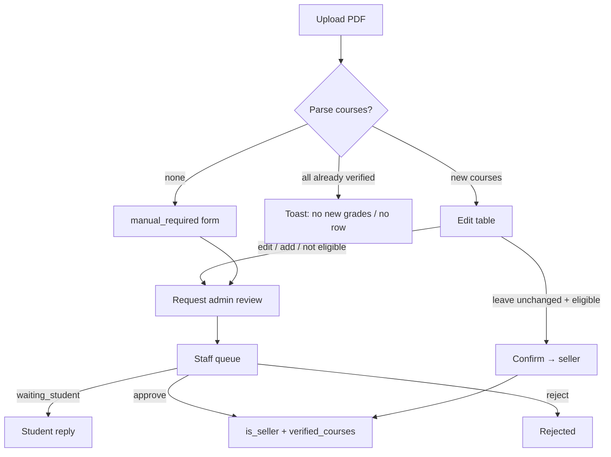

# Grade Verification — Logic & Process Analysis

**Date:** 2026-08-23  
**Scope:** Student upload → parse → confirm / manual / admin review → seller unlock  
**Sources:** `src/app/api/grades/**`, `src/lib/grades/**`, `src/app/(main)/grades/**`, `docs/GRADE_VERIFICATION.md`

This report describes **what the process actually does**, then **where the logic is wrong, incomplete, or confusing**. It does not change code.

---

## 1. Intended process (as designed)

```text
Student uploads PDF
        │
        ▼
Parse (Gemini → regex) + risk score
        │
        ├─ No courses found ──────────► manual_required
        │                                 └─ student types courses → admin queue
        │
        ├─ Courses found, already all verified ──► no new record (no_new_grades)
        │
        └─ New courses ───────────────► pending_review + confirmation_required
                                          │
                                          ├─ All Green + auto_approval_eligible
                                          │     └─ POST /confirm → approved, is_seller, verified_courses
                                          │
                                          └─ Edited / added / high risk
                                                └─ POST /admin-review → staff queue
                                                      ├─ approve → same unlock
                                                      └─ reject  → rejected + retain PDF
```

**Unlock rule:** seller access is `users.is_seller = true`. Note upload also requires a matching row in `verified_courses`.

---

## 2. Two status systems that do not mean the same thing

This is the root of most process confusion.

| Table | Status values | Meaning |
|-------|---------------|---------|
| `grade_verifications.status` | `manual_required`, `pending_review`, `approved`, `rejected` | Student-facing verification |
| `admin_review_requests.status` | `pending`, `reviewing`, `waiting_student`, `pending_reassignment`, `escalated`, `approved`, `rejected` | Staff queue |

`pending_review` on a verification is used for **three different student situations**:

1. Waiting for the student to confirm AI rows (`confirmation_required = true`)
2. Waiting for staff after “request admin review”
3. Waiting for staff after `/api/grades/manual` (PDF already deleted)

The UI labels all of these “Pending review”. Students cannot tell if they need to act, or if staff does.

`docs/GRADE_VERIFICATION.md` is **out of date**: it does not mention `verified_courses`, incremental re-upload, `waiting_student`, or cancel-as-reject.

---

## 3. Critical issues (wrong outcomes)

### 3.1 Auto-confirm trusts the client, not the stored transcript

`POST /api/grades/confirm` accepts `reviewRows` from the browser and decides “all green” from the **client `edited` flag**, not by comparing to the original parsed rows.

```94:105:src/app/api/grades/confirm/route.ts
    if (!summary.hasOnlyGreen) {
      return NextResponse.json(
        {
          error: {
            code: 'REQUIRES_MANUAL_REVIEW',
            message:
              'Rows include edits or user-added courses. Please request admin review instead of automatic confirmation.',
          },
        },
        { status: 409 }
      );
    }
```

`sanitizeCourseReviewRows()` treats any row with `source: 'ai'` and `edited: false` as Green, even if `courseCode` / `grade` were changed.

**Impact:** A crafted request can auto-approve invented or upgraded grades without staff review, then set `is_seller` and insert `verified_courses`.

**Fix:** Confirm only against the **server-stored** `review_rows` / `parsed_courses`. Reject if codes or grades differ. Ignore client `edited`.

---

### 3.2 Opening a review page claims the ticket

`GET /api/admin/grades/reviews/[requestId]` calls `claimAdminReviewRequest()`. Loading the detail page (or prefetch) moves the request to `reviewing` and locks it.

**Impact:**

- Accidental clicks lock work for other staff
- Queue counts jump from “Waiting Assignment” to “In Review” without an explicit Claim
- Assistants can steal unassigned items just by viewing

**Fix:** GET should be read-only. Claim only via the dedicated claim route.

---

### 3.3 Approval can succeed without unlocking selling or courses

On both student confirm and admin approve, these steps **log errors and continue**:

- `users.is_seller = true`
- `syncVerifiedCoursesForApproval()`

**Impact:** Status shows **Approved**, email is sent, but:

- Middleware still redirects `/notes/upload` to grade verification if `is_seller` failed
- Or `is_seller` is true but `verified_courses` is empty, so note upload fails with “not verified for this course”

There is no retry or compensating transaction.

**Fix:** Treat seller flag + course sync as part of the same success path. Fail the request (or retry) if either write fails. Add a repair job for already-approved orphans.

---

### 3.4 A second transcript can be uploaded while one is already in the staff queue

Upload blocks only if an in-progress row still has **storage** or **`confirmation_required`**:

```210:214:src/app/api/grades/upload/route.ts
    const activeVerification = (activeCandidates || []).find(
      (row) =>
        Boolean(row.transcript_storage_bucket && row.transcript_storage_path) ||
        Boolean(row.confirmation_required)
    );
```

After `POST /api/grades/manual`:

- status = `pending_review`
- `confirmation_required` stays `false` (set that way at insert)
- PDF path is cleared

That row is **not** treated as active. The student can start another verification while staff still has the first one.

Admin-review path usually keeps the PDF, so it is blocked — **only the manual path leaks**.

**Fix:** Treat any `pending_review` / `manual_required` (except cancelled) as blocking, or check for an open `admin_review_requests` row.

---

### 3.5 Manual submit deletes the only evidence, then staff is asked to approve it

`POST /api/grades/manual` deletes the stored PDF, then moves the record to `pending_review`. Admin review allows this path **without** a file or external URL (`canRequestFromManualSubmission`).

The upload UI mostly skips `/manual` and goes straight to `/admin-review` (keeps the PDF). The API still exists and is a hole.

**Impact:** Staff can be asked to approve typed grades with no transcript. If they approve, those grades become verified.

**Fix:** Never delete the PDF until approve/reject. Do not allow admin review without stored file or verified external link. Deprecate or lock `/api/grades/manual` if unused.

---

## 4. High issues (broken or misleading process)

### 4.1 Cancel is stored as a rejection

Cancel sets `status: 'rejected'` plus a hardcoded reviewer note (“Cancelled by you…”).

**Side effects:**

- Shows up in history as Rejected (status page special-cases the note; other UIs may not)
- Counts toward **daily upload quota**
- Becomes `latest` for **re-upload cooldown**
- Staff dashboards that count `rejected` mix cancellations with real rejects

**Fix:** Use a real status (`cancelled`) or `withdrawn`. Do not count cancels as rejects.

---

### 4.2 Student cannot cancel after requesting staff review

Cancel is allowed only for `manual_required` or `pending_review` **with** `confirmation_required`.

Requesting admin review sets `confirmation_required = false`. The student is stuck until staff acts, even if they uploaded the wrong file.

Cancel also **deletes** `admin_review_requests` in `pending`/`reviewing` if it ever ran — unsafe if a reviewer already started.

---

### 4.3 `pending_review` is overloaded — student UI cannot resume the right step

Upload page only resumes if `confirmation_required && review_rows`:

```232:244:src/app/(main)/grades/upload/page.tsx
        if (
          statusResponse.ok &&
          latest?.status === 'pending_review' &&
          latest.confirmation_required &&
          ...
        ) {
          setReviewVerificationId(latest.id);
```

If the latest row is in the **staff queue**, the student sees a generic upload form and may think they need to upload again (then hit 409 or start a duplicate — see 3.4).

Status page shows “Pending review” for both “confirm your courses” and “staff is working”.

**Fix:** Split student states: `awaiting_student_confirm` vs `in_admin_review` vs `waiting_student_reply`.

---

### 4.4 Admin can approve an empty course list and still grant seller

`validateCourseRows([])` returns no issues. Approve then:

- sets `is_seller = true`
- syncs **0** courses

Student becomes a seller who cannot upload notes for any course.

**Fix:** Require at least one valid course row before approve.

---

### 4.5 Verified grades can never be corrected

`unique (user_id, course_code)` plus sync **skips** existing codes. Re-upload of an updated transcript ignores courses already on file.

**Impact:** A wrong auto-approved grade (or a later official change) stays forever. Marketplace listings inherit that grade.

**Fix:** Staff-only grade correction, or allow update when a new approved transcript has a different grade for the same code.

---

### 4.6 GET-to-claim plus approve-from-`pending` is inconsistent

- Non-admin cannot approve while status is `pending` (must claim first)
- GET auto-claims, so this is hidden in the happy path
- Admin can approve from `pending` without claiming

Process depends on who opens the URL first.

---

## 5. Medium issues (inconsistent rules)

### 5.1 Grade allow-lists disagree

| Path | Allowed grades |
|------|----------------|
| Manual student submit | `A+` … `B-` only |
| Parser / confirm / admin validate | Full transcript set including `C`, `F`, `W`, `P`, … |

A student whose parse fails cannot manually enter a C course. After a successful parse, C can be auto-confirmed (if green + eligible).

---

### 5.2 Risk scoring almost never produces `reject`

Parser type includes `'reject'`, but scoring only returns `auto_verify` or `manual_review`. Hard-fail (not a transcript, no name, no courses) still becomes `manual_required` / queue, not reject.

Fraud-shaped PDFs still consume quota and staff time.

---

### 5.3 “Low risk” threshold is very tight

`riskLevel` is `low` only if score ≤ 1. Many normal signals add 2+ points (extraction quality, semester order). Those transcripts cannot auto-confirm even if every row is Green.

Students hit “request admin review” for ordinary official PDFs. That may be intentional, but the product copy says they can confirm after a successful parse.

---

### 5.4 Daily retry limit is counted incorrectly

Failed-attempt query:

```
status.eq.manual_required OR failed_parse_attempts.gt.0
```

A single `manual_required` row also has `failed_parse_attempts > 0`, so it can be counted twice. `failed_parse_attempts` stored on the row is `min(failedAttemptsToday + 1, …)`, mixing **lifetime-today count** into a **per-row** column.

Then `retryLimitReached` disables auto-approval on a **successful** later parse the same day.

---

### 5.5 Re-upload cooldown default is 0 hours

`GRADE_REUPLOAD_COOLDOWN_HOURS` defaults to `0`. Sellers can re-submit immediately (only daily quota applies). Combined with 3.4, they can stack queue items.

---

### 5.6 Profile gate is weaker than middleware

Upload checks `profile_completed` only. Middleware requires `profile_completed` **and** non-empty `full_name` and `school`. A half-complete profile can upload a transcript, then get redirected away from other pages.

---

### 5.7 Semester / year often never reach `verified_courses`

`extractCoursesFromVerification()` only copies semester from `parsed_transcript` when it reads **`parsed_courses`**. If `review_rows` exist (the normal confirm/admin path), semester fields are dropped.

Marketplace and “verified courses” then show grades without term.

---

### 5.8 Dead / duplicate student paths

| Path | Used by UI? | Result |
|------|-------------|--------|
| `/api/grades/confirm` | Yes (all-green) | Auto approve |
| `/api/grades/admin-review` | Yes (edits / parse fail) | Staff queue, keeps PDF |
| `/api/grades/manual` | Little / none | Staff-ish pending, **deletes PDF** |

Two “manual” processes with different evidence rules.

---

## 6. Process map: what the student actually experiences



**Gaps vs this map:**

- After A, student cannot cancel (4.2)
- After M via `/manual`, student can upload again (3.4)
- After C/V, a write failure still looks like success (3.3)
- “Resume” only works for the Confirm box, not for queue or waiting-student (4.3)

---

## 7. Staff process gaps

| Step | Problem |
|------|---------|
| Queue filters | `waiting_assignment` is a **filter alias** for `pending` + no assignee, not a stored status |
| Open detail | Auto-claim (3.2) |
| Request more info | `waiting_student` lives only on `admin_review_requests`; `grade_verifications` stays `pending_review` |
| Approve | No required course count; seller/sync not atomic |
| Reject | PDF retained (good); cancel also looks like reject (bad) |
| Docs | Still describe auto-approve without `verified_courses` incremental rules |

---

## 8. Recommended fix order

1. **Lock auto-confirm to stored rows** (3.1) — security  
2. **Stop GET from claiming** (3.2) — staff process  
3. **Atomic approve: status + seller + verified_courses** (3.3, 4.4)  
4. **Block re-upload while any non-final verification or open review exists** (3.4)  
5. **Keep PDF until final decision; retire `/api/grades/manual` or force file+URL** (3.5)  
6. **Add `cancelled` / split student statuses** (4.1, 4.3)  
7. **Allow student withdraw before staff claims** (4.2)  
8. **Align grade lists and persist semester on sync** (5.1, 5.7)  
9. **Update `docs/GRADE_VERIFICATION.md`** to match the real states and `verified_courses` rule  

---

## 9. What is working as intended

- Email + profile required before upload  
- Unknown catalog codes disable auto-approval  
- Edited / user-added rows (when the **UI** sets `edited: true`) cannot use `/confirm`  
- Admin reject requires reason + 10-character comment  
- High-risk approve requires `acknowledgeHighRisk`  
- Note upload checks **both** `is_seller` and `verified_courses` for that course code  
- Incremental re-upload skips already-verified codes (by design — but blocks corrections, 4.5)  

---

## 10. Suggested next step

Implement items **1–5** first; they change who can become a seller and what grades get stored. I can start with 3.1 + 3.2 + 3.4 if you want the process locked down before UI copy changes.
