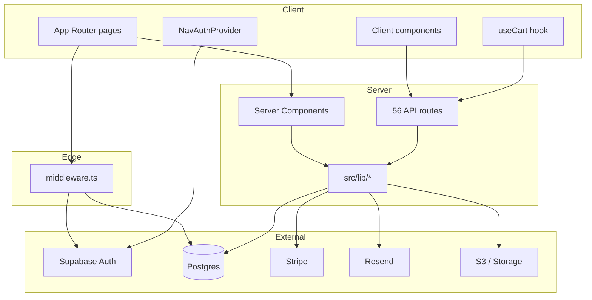
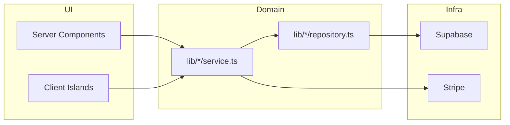

# UStudy Notes Platform — System Refactor Guide

> Living reference for architecture, pain points, and a phased refactor plan.  
> Last updated: 2026-08-23

---

## 1. What this app is

A **Next.js 14 (App Router)** marketplace where university students:

1. Verify grades (transcript upload → admin review)
2. Upload and sell course notes
3. Browse, cart, checkout (Stripe), and download purchased notes

**Stack:** React 18 · TypeScript · Tailwind · Supabase (Auth + Postgres + Storage) · Stripe · Resend · AWS S3 (presigned uploads) · Vercel-ready

---

## 2. High-level architecture



### Request layers

| Layer | Role | Key files |
|-------|------|-----------|
| **Edge middleware** | Session gate, profile redirect, admin RBAC | `src/middleware.ts` |
| **Server pages** | SSR data for marketplace, profile, cart | `src/app/(main)/**/page.tsx` |
| **Client pages** | Admin dashboards, auth forms, heavy forms | `src/app/admin/**`, `src/app/(auth)/**` |
| **API routes** | Mutations, webhooks, admin ops | `src/app/api/**/route.ts` |
| **Domain lib** | Business logic, queries, guards | `src/lib/**` |

---

## 3. Directory map

```
src/
├── app/
│   ├── (auth)/          # login, register, verify-email, forgot-password
│   ├── (main)/          # public + buyer/seller UX (home, courses, notes, cart, profile)
│   ├── admin/           # admin / assistant / support portals
│   ├── api/             # 56 REST route handlers
│   └── layout.tsx       # root shell (fonts, globals)
├── components/
│   ├── account/         # profile drawer, avatar, password form
│   ├── admin/           # admin shell, charts, queue panels
│   ├── cart/            # cart UI, add-to-cart, checkout client
│   ├── courses/         # search bar, course input
│   ├── layout/          # navbar, footer, mobile bar, NavAuthProvider
│   ├── marketplace/     # listings, carousels, skeletons
│   ├── materials/       # grade badges, material cards
│   ├── notes/           # listing cards
│   └── ui/              # shadcn primitives (button, card, label…)
├── hooks/
│   ├── useCart.ts       # client cart fetch + 15s cache
│   └── useSellerNav.ts  # re-export from NavAuthProvider
├── lib/
│   ├── auth/            # session, identity, admin-access, staff-emails
│   ├── cart/            # repository (Supabase admin client)
│   ├── courses/         # catalog search (cached)
│   ├── grades/          # transcript pipeline, admin review, parser
│   ├── notes/           # marketplace queries, listing utils
│   ├── stripe/          # checkout session creation
│   ├── supabase/        # server / client / admin clients
│   └── utils/           # cart math, cn()
├── middleware.ts
└── types/               # auth, cart

docs/migrations/         # 27 SQL migration files (001–027)
```

---

## 4. Domain modules

### 4.1 Authentication & identity

| Concern | Location | Notes |
|---------|----------|-------|
| Browser session | `@supabase/ssr` cookies | `createClient()` in server + client |
| Fast JWT read | `lib/auth/identity.ts` | `getClaims()` — used in middleware |
| Full profile | `lib/auth/session.ts` | `getCurrentAuthUser()` — server pages |
| RBAC | `lib/auth/admin-access.ts` | email allowlists + `user_roles` table |
| Route protection | `middleware.ts` | protected paths, profile-complete redirect |

**Protected paths:** `/profile`, `/cart`, `/checkout`, `/grades`, `/notes/upload`, `/admin`, …

### 4.2 Marketplace (notes)

| Concern | Location | Notes |
|---------|----------|-------|
| Homepage data | `lib/notes/marketplace.ts` | `getHomepageMarketplaceData()` |
| Course listings | `getPublishedListingsForCourse()` | cached 60s via `unstable_cache` |
| Listing detail | `getPublishedListingById()` | enriches with grades + seller label |
| **Pain point** | `fetchPublishedCourseSummaries()` | loads **all** published rows to aggregate |

### 4.3 Grade verification

| Concern | Location | Notes |
|---------|----------|-------|
| Upload | `app/(main)/grades/upload/page.tsx` | large client page |
| Parser | `lib/grades/parser.ts` | PDF/OCR + regex fallback |
| Admin review | `lib/grades/admin-review.ts` | workflow, assign, claim |
| Audit | `lib/grades/admin-audit.ts` | action log |

### 4.4 Cart & orders

| Concern | Location | Notes |
|---------|----------|-------|
| DB | `docs/migrations/026_cart_orders.sql` | `carts`, `cart_items`, `orders` |
| Repository | `lib/cart/repository.ts` | admin client, get-or-create cart |
| API | `api/cart/*`, `api/orders` | all `force-dynamic` |
| Checkout | `lib/stripe/checkout.ts` | Stripe Checkout Sessions |
| Webhook | `api/webhooks/stripe` | order fulfillment |

### 4.5 Admin portal

| Concern | Location | Notes |
|---------|----------|-------|
| Layout | `admin/layout.tsx` → `AdminPortalProvider` | fetches `/api/admin/me` client-side |
| Shell | `components/admin/admin-shell.tsx` | nav filtered by portal role |
| Pages | mostly `'use client'` | dashboard, grades queue, notes review |
| Guards | `lib/api/admin-guard.ts` | CSRF + role checks on API |

---

## 5. Data & caching

| Data | Cache strategy | Revalidate |
|------|----------------|------------|
| Course catalog | `unstable_cache` | 3600s |
| Marketplace summaries | `unstable_cache` | 60s |
| Cart / profile / admin API | `force-dynamic` | none |
| Client router (Next 14) | `staleTimes.dynamic: 30` | 30s in-memory |

**Supabase clients:**

- `lib/supabase/server.ts` — cookie-based, RLS-aware (user context)
- `lib/supabase/client.ts` — browser
- `lib/supabase/admin.ts` — service role (bypasses RLS; server-only)

---

## 6. Known issues & tech debt

### Performance (navigation feels slow)

| Issue | Where | Impact |
|-------|-------|--------|
| Client pages fetch after mount | `admin/page.tsx`, `grades/upload`, auth pages | blank → "Loading…" on every visit |
| Cart badge fetch | `CartNavLink` → `useCart` | extra API call when logged in |
| Nav auth client fetch | `NavAuthProvider` | Supabase session + `users.is_seller` on mount |
| Middleware on protected routes | `middleware.ts` | JWT + optional DB on `/cart`, `/profile`, … |
| Full-table marketplace aggregate | `fetchPublishedCourseSummaries` | RPC `get_published_course_listing_stats` with row fallback |
| Full-table letter counts | `getCourseLetterCounts` | RPC `get_course_letter_counts` with paged fallback |
| Catalog prefetch storm | `/courses` letter chips + rows | `prefetch={false}` on dense link lists |
| Blank main loading UI | `(main)/loading.tsx` | removed so previous page stays visible |
| Dev mode compilation | `next dev` | first hit per route compiles (~2–15s) |
| Broad loading UI | `(main)/loading.tsx` | full-page skeleton on all main routes |

### Architecture

| Issue | Where | Recommendation |
|-------|-------|----------------|
| Duplicate auth checks | middleware + API + client | single server-side `getCurrentAuthUser()` per request |
| Admin pages all client | `src/app/admin/**` | convert read-heavy pages to RSC + small client islands |
| 56 API routes, many similar | `src/app/api/**` | extract shared handlers; typed route helpers |
| `force-dynamic` everywhere | most API routes | use `revalidate` where reads are safe |
| Unused deps | `next-intl`, `framer-motion` | remove or wire up |
| Legacy login API | `api/auth/login` | deprecated; browser uses Supabase client |
| Profile placeholders | orders, purchases, sales, wallet | stub pages only |

### Security / ops

| Item | Status |
|------|--------|
| RLS policies | verify per table in Supabase |
| Service role in lib | never import `adminClient` in client bundles |
| Stripe webhook idempotency | confirm in `api/webhooks/stripe` |
| Rate limiting | `@upstash/ratelimit` on auth routes |

---

## 7. Refactor plan (phased)

### Phase A — Quick wins (1–2 days)

**Goal:** Faster navigation without big rewrites.

- [x] Remove unused `next-intl` from root layout (done)
- [x] Enable `staleTimes` in `next.config.mjs` (done)
- [x] Server-render profile, cart, verified-courses (done)
- [x] Middleware: `getClaims()` + profile cookies (done)
- [x] Pass nav auth from server layout instead of client `NavAuthProvider` fetch
- [x] Add route-specific `loading.tsx` only where needed; narrow `(main)/loading.tsx`
- [x] DB aggregate for course summaries (replace full-table scan)
- [ ] Run `docs/migrations/025_performance_indexes.sql` if not applied
- [ ] Run `docs/migrations/028_published_course_stats.sql` and `029_course_letter_counts.sql`

### Phase B — Server-first pages (3–5 days)

**Goal:** Eliminate client fetch waterfalls.

| Page | Current | Target |
|------|---------|--------|
| `admin/page.tsx` | client + `/api/admin/dashboard` | RSC loads dashboard data in page |
| `admin/grades/page.tsx` | client | RSC + client filter bar only |
| `admin/summary/page.tsx` | client + recharts | server data + client chart island |
| `grades/status/page.tsx` | client | RSC with status from lib |
| `checkout/page.tsx` | client shell | server auth gate + client Stripe only |

**Pattern:**

```tsx
// page.tsx (server)
export default async function AdminDashboardPage() {
  const data = await getAdminDashboardData(); // lib/admin/dashboard.ts
  return <AdminDashboardClient initialData={data} />;
}
```

### Phase C — API consolidation (3–5 days)

**Goal:** Less duplication, clearer boundaries.

1. **Auth helper** — `lib/api/with-auth.ts`
   ```ts
   export async function withAuth(handler: (user: AuthUser) => Promise<Response>)
   ```
2. **Admin helper** — extend `lib/api/admin-guard.ts` for all admin routes
3. **Group routes by domain** under `lib/` not `app/api` logic:
   - `lib/cart/service.ts`
   - `lib/orders/service.ts`
   - `lib/profile/service.ts`
4. **Delete** deprecated `api/auth/login` or mark removed in docs

### Phase D — Admin & grades modularization (1–2 weeks)

Split large files:

| File | Lines concern | Split into |
|------|---------------|------------|
| `grades/upload/page.tsx` | monolithic client page | steps: upload, confirm, materials |
| `admin/grades/[requestId]/page.tsx` | review UI + actions | panels + action hooks |
| `lib/grades/parser.ts` | OCR + regex + validation | `parser/ocr.ts`, `parser/regex.ts` |
| `lib/grades/admin-review.ts` | workflow + DB | `review/queries.ts`, `review/actions.ts` |

### Phase E — Product completion

- [ ] Implement real `profile/orders`, `purchases`, `sales`, `wallet` (currently placeholders)
- [x] Post-purchase download flow
- [ ] Seller payout / wallet ledger
- [ ] E2E tests (Playwright already in devDependencies)

---

## 8. Target architecture (after refactor)



**Rules:**

1. **Pages fetch data** — API routes only for mutations, webhooks, and external callbacks.
2. **One auth read per request** — middleware sets cookies; layouts pass user down.
3. **Admin client islands** — charts, modals, live refresh only.
4. **Cache reads** — marketplace + catalog; never cache cart/orders/profile.

---

## 9. File rename / move candidates

| Current | Suggested | Reason |
|---------|-----------|--------|
| `hooks/useSellerNav.ts` | delete; import from `NavAuthProvider` directly | thin re-export |
| `lib/auth/session.ts` + `identity.ts` | merge or document split clearly | two entry points |
| `components/marketplace/*` + `components/notes/*` | `features/marketplace/` | feature folders |
| `app/api/admin/*` logic | `lib/admin/*` | fat routes → thin routes |
| `i18n/request.ts` | remove if unused | dead next-intl config |

---

## 10. Environment checklist

Required in `.env.local` (see `.env.example`):

| Variable | Used by |
|----------|---------|
| `NEXT_PUBLIC_SUPABASE_URL` | all Supabase clients |
| `NEXT_PUBLIC_SUPABASE_ANON_KEY` | browser + server user client |
| `SUPABASE_SERVICE_ROLE_KEY` | admin client, cart, marketplace |
| `STRIPE_SECRET_KEY` / `NEXT_PUBLIC_STRIPE_PUBLISHABLE_KEY` | checkout |
| `STRIPE_WEBHOOK_SECRET` | webhook |
| `RESEND_API_KEY` | email verification |
| `ADMIN_PORTAL_EMAILS` etc. | staff RBAC |

---

## 11. Migration order (new environments)

Run in Supabase SQL Editor in numeric order:

```
001 → 027  (docs/migrations/)
```

Critical for current features:

- `006` or `004` — profile fields
- `015` — verified courses
- `016` — note listings
- `019` — courses catalog (+ `npm run seed:courses`)
- `026` — cart & orders
- `027` — avatar URL

---

## 12. How to use this doc

1. Pick a **phase** (A–E) based on priority.
2. Before touching a module, read its **domain section** (§4) and **debt row** (§6).
3. After changes, run `npm run build` and smoke-test: home → course → note → cart → checkout.
4. Update this file when a checkbox is completed or architecture shifts.

---

## 13. Related docs

| Doc | Purpose |
|-----|---------|
| `docs/FIX-PHASE-1-GUIDE.md` | Auth bootstrap, early setup |
| `docs/AUTH_DB_SETUP.md` | Supabase auth tables |
| `docs/GRADE_VERIFICATION.md` | Transcript verification flow |
| `graphify-out/GRAPH_REPORT.md` | Code graph & god nodes |

---

## 14. God nodes (most connected — refactor carefully)

From graph analysis — high fan-out; changes ripple widely:

1. `cn()` — `lib/utils.ts`
2. `createClient()` — Supabase server/client
3. `Button`, `Card` — UI primitives
4. `requireAdminUser()` / `requireVerificationReviewer()` — admin guards
5. `normalizeCourseCode()` — courses + grades + listings

When refactoring these, run full build + manual admin + marketplace smoke tests.
